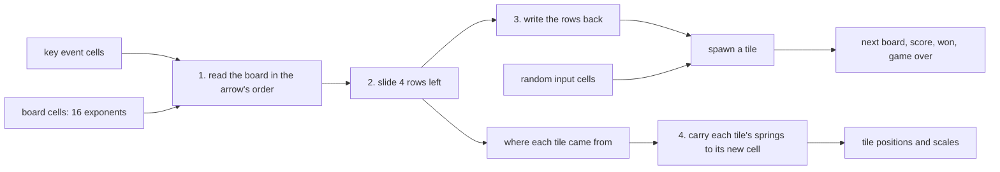

# 2048

The game 2048 written as one numeric program: every key press runs the same fixed list of about 7,000 operations (weighted sums, products and ReLUs over FP32 numbers) with no `if` and no loop at runtime. The program slides and merges the tiles, spawns new ones, keeps the score and the best score, notices a win or a dead end, and animates every tile with springs.

```sh
bun run start:2048     # the game, at http://localhost:3000/
bun test game2048      # the program against the plain JavaScript rules, in about 0.5 s
bunx tsc -p .          # the type-check
```

Arrow keys, WASD or a swipe move the tiles, and N or the button starts a new game. The best score is kept in localStorage.

## Files, in reading order

- `rules.ts`: the whole game in about 100 lines of plain JavaScript. Read this first, since it's the spec the program follows.
- `game.ts`: the same rules as builder code. It runs once, and each line appends the operations of one expression, which the comment above it shows in JavaScript.
- `machine.ts`: the host, i.e. the JavaScript around the program. It queues key presses, writes the key and the random numbers into the program's input cells, runs the program, and writes the next state back.
- `page.ts`, `index.html` and `main.ts`: the page. It reads keys and swipes, and draws the program's output numbers. Nothing here knows the rules.
- `inspector.ts`: the panel beside the board, which shows how the program slid one line on the last arrow key. See [The inspector](#the-inspector).
- `game2048.test.ts`: plays the program and `rules.ts` side by side.

## How the program works



**Numbers.** A cell holds an exponent, 0 for empty and e for the tile 2^e, so every number in the game is a small whole number. Whole numbers matter for two reasons: FP32 adds and multiplies them exactly, and `emitCompare` compares two of them in about 2 operations. Without the promise that they're whole, a comparison takes about 15. `createVocabulary` in game.ts explains where that promise has to be written down by hand.

**Branches become arithmetic.** `if (bit) x else y` becomes `bit × x + (1 - bit) × y`, which is a product with a ReLU (`gate`) and a sum. `a && b` becomes `max(0, a + b - 1)`. Both sides of every `if` are computed on every key press, and the bits pick one.

**1. Every move is a move to the left.** Like many 2048 implementations, the program only knows how to slide a row to the left. It reads the board in the order of the pressed arrow: moving down, "row" 0 is column 0 read from the bottom up. Since it can't branch on the arrow, it reads every cell as a sum over the 4 directions, `Σ key[direction] × board[lineCell(direction, line, position)]`, and only the pressed key's term isn't 0. Writing the rows back is the same sum the other way around.

**2. Sliding one row has no loop either** (`slideRowLeft`):

- *Pack.* A tile lands in the slot numbered by how many tiles are before it, so `tilesBefore` is a running sum of "occupied" bits, and `packedFrom[slot][position]` is the bit `occupied && tilesBefore === slot`.
- *Merge.* A neighbor pair merges when it's equal and the pair before it didn't merge: `merges[slot] = equal && !merges[slot - 1]`. A row has only 3 pairs, so this chain is 3 steps long.
- *Pack again.* A surviving tile moves left by the number of merges before it, and a second bit matrix, `lands[slot][final]`, places it.

Each step also produces where each tile came from, `from[final][position]`, which the animation needs.

**3. Randomness comes from the host.** The program can't call `Math.random()`, so the host draws two numbers per key press and writes them into input cells. The program turns them into "the k-th empty cell" by comparing against thresholds, with `k = floor(slot × emptyCount / 720720)`. 720720 is the least common multiple of 1..16, so every empty cell is equally likely, and both versions place tiles identically from the same numbers. That's what lets the test compare them move by move.

**4. Animation without tile identities.** The board only stores numbers per cell, not "tile #37". So each cell owns the springs of whatever tile it holds: an x offset, a y offset and a scale. When a key moves a tile from cell q to cell p, the program carries q's spring state into p with the same `from` bits, and moves the spring's destination by the distance from q to p. The tile is drawn where it was and springs toward its new cell. `emitAnimatedObject` already supports that kind of jump as `destinationDuringSteps`, because the host's spring steps simulate the time *before* the key, when the tile was still heading for q. A merge also leaves a *ghost*: the tile that merged away slides in under the merged tile, showing its old number. New tiles restart at scale 0 and merged ones at scale 1.15, and both spring back to 1.

## The inspector

The panel beside the board shows the last arrow key from the inside. `buildGame` also returns `inspect`, which holds wires the program computes anyway: each line as read in the arrow's order, every step of `slideRowLeft` on it (`occupied`, `tilesBefore`, `packedFrom`, `packed`, `merges`, `survives`, `finalSlot`, `lands`, `line`, `gain`), the spawned tiles and the next board. On each arrow key, machine.ts runs a second evaluator with `inspect` as its output, on the same table as the key's evaluation. The panel only draws those values and never computes a rule.

- The strip shows one line's slide from top to bottom, and plays its steps after each key. The panel picks the line with the most merges, and the buttons above it pick another. Each bit matrix is drawn as a switchboard: a wire from where a tile was to where it goes, lit where the bit is 1.
- Hovering a value shows the JavaScript it stands for and the arithmetic of the operations on the values above it, e.g. `merges[0]` as `relu(filled[1] + equal − 1)`. The panel redoes that arithmetic only to display it, and the result is always the wire's own value.
- While the strip plays, and while the pointer is over the panel, the board shows the order in which the arrow reads each line, with the shown line outlined and its positions numbered.
- The overview counts the program's operations by depth, i.e. by the longest chain of operations from the source table to each one, colored by the part of `buildGame` that appended them. It marks the layers of the shown step or the hovered value. Sliding all 4 rows takes about 1,100 operations, and the springs take about 5,100 of the 7,090.

## What the test checks

- `slideLine`'s classic edge cases: `[2, 2, 2, 2]` gives `[4, 4]`, a new 4 doesn't merge again in the same move, and so on.
- The program slides the same lines as `slideLine` in all 4 directions.
- 5 seeded games played to the end, with key presses 1 to 40 ms apart: after every key, the program's board, score, best, win and game-over bits equal `rules.ts`'s exactly.
- The animation: a sliding tile starts exactly at its old cell, a merged tile starts at scale 1.15 with its ghost at the old cell. After 400 keys mashed 3 ms apart, every spring is still within its declared range (the evaluator throws otherwise), and everything comes to rest exactly at home.

## Things to try

- Change `springConstants`, `mergeJump` or `spawnJump` at the top of game.ts for a different feel.
- Print `buildGame().circuit.roundingPoints()` grouped by kind. A comparison built without a whole-number promise shows up as a long `'sign cascade'` instead of an `'integer bit'`.
- The README of the repo mentions unfreezing a program's weights and training them. Here every weight is hand-written. Try nudging one in `slideRowLeft` and watch which rules break first.
